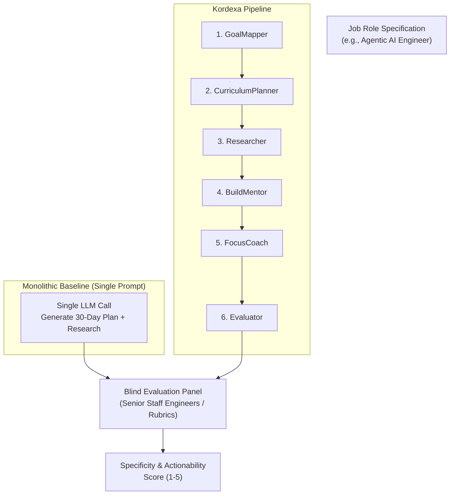

# Kordexa Documentation — Empirical Evaluation Plan

**Document Status:** Complete  
**Date:** 2026-10-29  
**Version:** 1.0.0  
**Target Publication Venues:** ACM SIGCSE / IEEE Transactions on Learning Technologies / FSE Tools

---

## 1. Executive Summary and Evaluation Philosophy

Kordexa is a local-first learning orchestrator that combines CLI-based project scaffolding, daily automated email delivery, and multi-agent persona decomposition.

To evaluate whether Kordexa provides measurable advantages over alternative paradigms, this evaluation plan defines **fair, controlled, and reproducible experimental protocols**. It deliberately distinguishes between **completed mechanical verifications** (automated regression and integration testing) and **planned empirical evaluations** (human user trials and synthetic LLM benchmarking).

---

## 2. Baselines and Experimental Conditions

To evaluate Kordexa honestly, we define three comparative conditions across identical 30-day learning curricula:

```
+---------------------------------------------------------------------------------------+
|                               EXPERIMENTAL CONDITIONS                                 |
+---------------------------------------------------------------------------------------+
| Condition A: Baseline Static Self-Study (Control)                                     |
|   - Fixed curriculum checklist (Spreadsheet / Markdown document)                      |
|   - Standard web search and documentation browsing                                    |
|   - Self-managed reminder schedule (no automated triggers)                            |
+---------------------------------------------------------------------------------------+
| Condition B: Generic Conversational LLM Tutor                                         |
|   - Single-prompt interactive chatbot (e.g., standard ChatGPT or Claude session)       |
|   - Unstructured conversational Q&A without persistent local state tracking           |
|   - Ad-hoc code reviews and manual task prompts                                       |
+---------------------------------------------------------------------------------------+
| Condition C: Kordexa System (Treatment)                                        |
|   - Agent-native execution harness + sequential 6-role decomposition                  |
|   - Automated daily delivery via GitHub Actions + personal SMTP                       |
|   - Verifiable evidence logging (`data/progress-log.json`) and progression cards      |
+---------------------------------------------------------------------------------------+
```

---

## 3. Evaluation Dimensions and Formal Metrics

### Metric 1: 30-Day Task Completion Rate (TCR)
- **Operational Definition:** The ratio of days where verifiable proof (code commit, test output, or working demo) is produced and logged, relative to the 30 planned days:
  $$\text{TCR} = \frac{\sum_{i=1}^{30} \mathbb{I}(\text{ProofProduced}_i)}{30}$$
- **Measurement Procedure:** Inspection of Git repository commit history and `progress-log.json` timestamps.
- **Experimental Unit:** Single learner over a 30-day period.
- **Baseline:** Condition A (Static Self-Study, historical industry average $< 20\%$ for self-paced MOOCs).
- **Hypothesis:** $\text{TCR}_{\text{Kordexa}} > \text{TCR}_{\text{GenericLLM}} > \text{TCR}_{\text{Static}}$.
- **Threats to Validity:** Self-selection bias of participants; hawthorne effect (participants knowing they are monitored).

### Metric 2: Task Execution Latency and Setup Friction (TEL)
- **Operational Definition:** Wall-clock time (seconds) required from initiating a study session to writing the first line of code for the daily build artifact.
- **Measurement Procedure:** Instrumented screen recording and CLI command timestamps (`harness` -> `research` -> first code commit).
- **Experimental Unit:** Single daily study session.
- **Baseline:** Condition A (manual search and setup) vs. Condition C (automated link resolution and harness).
- **Hypothesis:** Condition C reduces friction latency by $\ge 40\%$ due to pre-resolved official docs, repos, and videos.

### Metric 3: Context Token Consumption & Monetary Cost (CTC)
- **Operational Definition:** Total input and output LLM tokens consumed by the host coding agent per day to understand the curriculum and execute the daily loop.
- **Measurement Procedure:** Host agent token metrics logger (measuring token counts with `harness.json` vs. without harness).
- **Experimental Unit:** Single agent session completing a daily milestone.
- **Baseline:** Naive agent session (reading entire repository context without harness policies).
- **Hypothesis:** The token-conscious execution harness reduces token consumption by $\ge 50\%$ by explicitly declaring load order and preventing raw chat dumping.

### Metric 4: Recovery from Injected System Failures (RIF)
- **Operational Definition:** System resilience when encountering simulated real-world failures (network drop, SMTP credential rejection, corrupted config, empty plan).
- **Measurement Procedure:** Automated fault-injection suite asserting graceful degradation, informative stderr messages, and non-destructive fallbacks.
- **Experimental Unit:** Automated execution run.
- **Status:** **Completed and Verified in Test Suite** (e.g., offline link resolution fallback, empty plan auto-regeneration, corrupt JSON handling).

---

## 4. Detailed Experimental Protocols

### Experiment 1: Synthetic Multi-Agent Role Decomposition Ablation (Phase P3)



#### Protocol:
1. Generate curricula for 20 diverse technical job roles using:
   - Pipeline 1: Monolithic zero-shot prompt.
   - Pipeline 2: Kordexa sequential 6-role prompt contracts (`references/agent-contracts.md`).
2. Blind evaluation by three independent domain experts on a 5-point Likert scale across:
   - **Construct Validity:** Are foundational prerequisites sequenced before advanced topics?
   - **Artifact Feasibility:** Can the daily build artifact realistically be implemented in 45–75 minutes?
   - **Verification Rigor:** Are the review questions and proof requirements concrete and checkable?
3. Statistical analysis: Paired Wilcoxon signed-rank test ($\alpha = 0.05$).

### Experiment 2: Human Developer Pilot Trial (Planned)

#### Protocol:
- **Cohort Size:** $N = 30$ developers (15 randomized to Control Condition A, 15 to Treatment Condition C).
- **Duration:** 30 consecutive calendar days.
- **Target Role:** "Agentic AI and LLM Engineer".
- **Instruments:**
  - Pre-study diagnostic coding test (Python, embeddings, API wrappers).
  - Daily automated log collection (`progress-log.json` and Git remote commit logs).
  - Post-study identical diagnostic test + System Usability Scale (SUS) questionnaire.
  - Qualitative exit interviews (15 minutes semi-structured).
- **Ethical Standards:** Voluntary participation, full informed consent, zero cloud telemetry, participant data anonymization.

---

## 5. Completed vs. Planned Evidence Status

| Evaluation Item | Status | Verified Evidence |
|---|---|---|
| **Zero-dependency build integrity** | VERIFIED | `npm test` runs in ~240ms with 0 npm dependencies |
| **Fail-soft offline resilience** | VERIFIED | `isLinkResolutionOffline` verified in unit tests |
| **Corrupted data file recovery** | VERIFIED | `readJson` corruption test verified in test suite |
| **Scheduled window bounds** | VERIFIED | Plan-complete skip logic tested against date offsets |
| **Multi-agent ablation experiment** | PLANNED | Benchmark script designed; awaiting synthetic run |
| **Human user cohort trial** | PLANNED | Protocol formalized; recruitment pending |

---

## 6. Threats to Validity

### 6.1 Internal Validity
- **Self-Reported Evidence:** In the human trial, logged minutes and confidence scores are subjective. Mitigated by cross-referencing Git commit diffs and build outputs.
- **Model Version Drift:** Changes in backend LLMs (Claude, GPT, Gemini) across the 30-day trial could alter agent behavior. Mitigated by pinning API model snapshots (e.g., `claude-3-5-sonnet-20241022`).

### 6.2 External Validity
- **Generalizability across Roles:** While the system includes 4 tuned blueprints, custom roles rely on blueprint matching. Results on Agentic AI may not generalize identically to Embedded Systems or DevOps.

### 6.3 Construct Validity
- **Definition of "Learning":** Completing code artifacts does not guarantee long-term conceptual mastery. Pre- and post-tests must evaluate both code execution skills and architectural reasoning.

