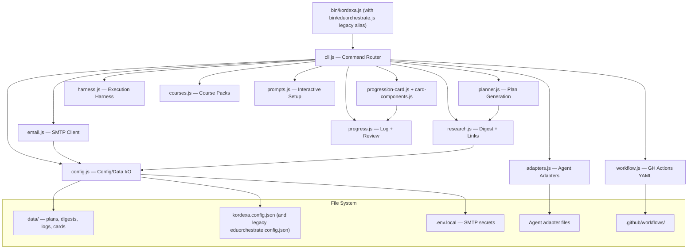

# Kordexa Documentation — Project Audit & Current State Analysis

**Audit date:** 2026-10-29  
**Auditor:** Automated code review and manual inspection  
**Project version:** 0.4.2  
**Runtime:** Node.js 18+ (ES modules, zero runtime dependencies)  
**License:** MIT  
**Author:** Haroon K M (https://haroon.pro/)

---

## 1. Project Purpose and Intended Users

**Purpose:** Kordexa is a CLI-based learning orchestrator that turns a target job role into a personalized, adaptive daily study plan. It runs locally inside whichever AI coding agent the learner already uses (Claude Code, Codex, Gemini, etc.) and produces one focused build artifact per day with sourced research, scheduled email delivery, and skill progression tracking.

**Intended users:** Self-directed developers and job-seekers who work in CLI/agent environments and want structured, evidence-based learning paths toward specific technical roles.

**Classification:** VERIFIED — confirmed via source code inspection, CLI execution, and test suite.

---

## 2. Problem Statement

Traditional learning tools are SaaS dashboards that collect courses users rarely complete. They lack:
- Integration with the developer's actual workflow
- Daily accountability with artifact-based proof
- Local-first privacy (no telemetry, no cloud storage)
- Vendor-neutral operation across multiple AI coding assistants

**Classification:** VERIFIED — documented in README and confirmed by architecture.

---

## 3. Existing Capabilities and User Workflows

### 3.1 Verified Capabilities (VERIFIED via code + test execution)

| Capability | Source File(s) | Test Coverage |
|---|---|---|
| Interactive onboarding with profile capture | `src/cli.js` L41-93, `src/prompts.js` | Yes (non-interactive `--yes` mode) |
| 30-day minimum adaptive plan generation | `src/planner.js` L150-170 | Yes (multiple tests) |
| 4 role blueprints (Agentic AI, Full-Stack, Cybersecurity, Data Science) | `src/planner.js` L3-148 | Yes |
| Plan extension beyond 30 days | `src/planner.js` L154, `src/cli.js` L104 | Yes |
| Per-agent adapter writing (7+ agents) | `src/adapters.js` | Yes (setup test) |
| GitHub Actions workflow generation | `src/workflow.js` | Yes (cron test) |
| Research digest creation with search URLs | `src/research.js` L31-57 | Yes |
| Live link resolution (YouTube + GitHub API) | `src/research.js` L100-228 | Yes (stubbed fetch) |
| Offline fallback for link resolution | `src/research.js` L69-73 | Yes |
| Daily email rendering (text + HTML) | `src/planner.js` L256-422 | Yes |
| SMTP email sending (implicit TLS + STARTTLS) | `src/email.js` | Dry-run only |
| Dry-run email preview | `src/cli.js` L112 | Yes |
| Progress logging with evidence | `src/progress.js` L4-20 | Yes |
| Weekly summary generation | `src/progress.js` L43-60 | Yes |
| Momentum tracking (strong/steady/blocked/not-started) | `src/progress.js` L79-87 | Indirect |
| Skill progression card generation (Markdown + JSON) | `src/progression-card.js` | Indirect |
| Terminal card SVG generation | `src/card-components.js` | Indirect |
| Status reporting | `src/progress.js` L62-73 | Yes |
| Next-skill recommendation | `src/cli.js` L235-255 | Indirect |
| Scheduled day resolution from startDate | `src/cli.js` L150-157 | Yes (3 tests) |
| Plan-complete skip for scheduled sends | `src/cli.js` L116-127 | Yes |
| Doctor (health check) | `src/cli.js` L296-308 | No |
| Setup-secrets (GH Actions secret commands) | `src/cli.js` L275-290 | No |
| Token-conscious execution harness | `src/harness.js` | Indirect |
| Role-specific course packs | `src/courses.js` | Indirect |
| Config and data-dir resolution | `src/config.js` | Implicit |
| `.gitignore` management | `src/config.js` L38-52 | Implicit |
| `.env.local` credential storage | `src/config.js` L54-59 | Implicit |
| MCP server adapter | `.kordexa/mcp/server.js (and .eduorchestrate/mcp/server.js)` | No |

### 3.2 Documented but Not Independently Verified (DOCUMENTED)

| Claim | Source | Status |
|---|---|---|
| "Typed multi-agent workflow" (GoalMapper→CurriculumPlanner→…→Evaluator) | README, spec.c4 | DOCUMENTED — The 6 agent roles are documented in skill files as instructions for the AI coding agent to follow. They are **not** implemented as separate programmatic agents in `src/`. The single AI model executes all roles sequentially. |
| "Trend-aware research reshapes the roadmap" | README | DOCUMENTED — `src/research.js` generates digests with a `trendAdaptation` text field, but no code actually modifies the plan based on trend analysis. The reshaping is delegated to the AI agent reading the instructions. |
| GitHub Actions scheduled delivery | README, `src/workflow.js` | DOCUMENTED — The YAML file is generated correctly, but actual scheduled execution requires a GitHub repository with configured secrets. Not testable locally. |
| SMTP email sending | README, `src/email.js` | DOCUMENTED — Implementation exists and is well-engineered (custom SMTP client with TLS), but no test exercises actual sending (only dry-run). |

---

## 4. Source-Code Organization

### 4.1 Module Map

| File | Lines | Responsibility |
|---|---|---|
| [`src/cli.js`](file:///Users/cibirajanv/Projects/edu/kordexa/src/cli.js) | 434 | Command router, onboarding, all CLI subcommands |
| [`src/planner.js`](file:///Users/cibirajanv/Projects/edu/kordexa/src/planner.js) | 422 | Role blueprints, plan generation, email rendering |
| [`src/research.js`](file:///Users/cibirajanv/Projects/edu/kordexa/src/research.js) | 286 | Research digests, live link resolution (YouTube/GitHub), offline fallback |
| [`src/email.js`](file:///Users/cibirajanv/Projects/edu/kordexa/src/email.js) | 161 | Custom SMTP client (TLS/STARTTLS), MIME composition |
| [`src/courses.js`](file:///Users/cibirajanv/Projects/edu/kordexa/src/courses.js) | 150 | Role-specific course catalog and newsletter pack |
| [`src/adapters.js`](file:///Users/cibirajanv/Projects/edu/kordexa/src/adapters.js) | 149 | Writes per-agent adapter files for 7+ runtimes |
| [`src/progression-card.js`](file:///Users/cibirajanv/Projects/edu/kordexa/src/progression-card.js) | 137 | Progression card (Markdown, JSON, terminal SVG) |
| [`src/harness.js`](file:///Users/cibirajanv/Projects/edu/kordexa/src/harness.js) | 122 | Token-conscious execution harness |
| [`src/card-components.js`](file:///Users/cibirajanv/Projects/edu/kordexa/src/card-components.js) | 103 | SVG component renderer |
| [`src/progress.js`](file:///Users/cibirajanv/Projects/edu/kordexa/src/progress.js) | 87 | Progress logging, review, weekly summaries, status |
| [`src/prompts.js`](file:///Users/cibirajanv/Projects/edu/kordexa/src/prompts.js) | 76 | Interactive onboarding prompts (stdin/stdout) |
| [`src/config.js`](file:///Users/cibirajanv/Projects/edu/kordexa/src/config.js) | 74 | Config I/O, data-dir resolution, .env parsing |
| [`src/workflow.js`](file:///Users/cibirajanv/Projects/edu/kordexa/src/workflow.js) | 45 | GitHub Actions YAML generation |
| [`bin/kordexa.js (with bin/eduorchestrate.js legacy alias)`](file:///Users/cibirajanv/Projects/edu/kordexa/bin/kordexa.js (with bin/eduorchestrate.js legacy alias)) | 7 | Entry point shebang |
| [`tests/node/eduorchestrate.test.js`](file:///Users/cibirajanv/Projects/edu/kordexa/tests/node/eduorchestrate.test.js) | 466 | Node.js built-in test runner suite |

**Total source:** ~2,253 lines (src/ + bin/)  
**Total with tests:** ~2,719 lines

### 4.2 Dependency Analysis

**Runtime dependencies:** Zero. The entire CLI uses only Node.js built-in modules:
- `node:fs`, `node:path`, `node:os` — File I/O
- `node:net`, `node:tls` — SMTP client
- `node:crypto` — Message IDs, MIME boundaries
- `node:readline` — Interactive prompts
- `node:test`, `node:assert/strict` — Test runner (dev only)
- Global `fetch` — Link resolution (Node 18+ built-in)

**Classification:** VERIFIED — no `node_modules`, no `package-lock.json`, no install step required.

---

## 5. Architecture and Component Interactions

### 5.1 Architecture Type

Kordexa is a **single-process CLI application** that generates instructions and data files for external AI coding agents. It is **not** a multi-agent runtime. The "typed multi-agent workflow" described in the README is an instructional framework — the agent roles (GoalMapper, CurriculumPlanner, Researcher, BuildMentor, FocusCoach, Evaluator) are defined in Markdown skill files that an external AI model follows.

**Classification:** VERIFIED — no agent runtime, orchestration loop, or inter-agent communication exists in `src/`.

### 5.2 Component Interaction Diagram



### 5.3 Data Flow

1. **Setup:** User runs `npx kordexa` → interactive prompts → config saved → adapters written → plan generated → GH Actions workflow emitted → research digest created → harness and course pack saved.
2. **Daily loop:** User (or agent) runs subcommands → each reads config + plan from disk → performs operation → writes output to `data/` → prints JSON to stdout.
3. **Scheduled delivery:** GH Actions cron → `node bin/kordexa.js (with bin/eduorchestrate.js legacy alias) send-today` → resolves day from `schedule.startDate` → composes email → sends via SMTP.

### 5.4 State Management

All state is file-backed JSON in `data/` (git-ignored). There is no database, no in-memory persistence across commands, and no locking.

**Classification:** VERIFIED.

---

## 6. Agent Definitions and Orchestration

### 6.1 Skill Files

The canonical skill is at [`skills/eduorchestrate/SKILL.md`](file:///Users/cibirajanv/Projects/edu/kordexa/skills/eduorchestrate/SKILL.md) with references:
- [`references/agent-contracts.md`](file:///Users/cibirajanv/Projects/edu/kordexa/skills/eduorchestrate/references/agent-contracts.md) — Defines the 6 typed agent roles
- [`references/learning-system.md`](file:///Users/cibirajanv/Projects/edu/kordexa/skills/eduorchestrate/references/learning-system.md) — Learning system design

### 6.2 Adapters Written on Setup

| Agent | Adapter Path |
|---|---|
| Claude Code | `.claude/skills/eduorchestrate/SKILL.md` |
| Codex | `AGENTS.md` (top-level) |
| Gemini | `GEMINI.md` (top-level) |
| OpenClaw | `.kordexa/adapters/ (and .eduorchestrate/adapters/)openclaw/SKILL.md` |
| Antigravity | `.kordexa/adapters/ (and .eduorchestrate/adapters/)antigravity/manifest.json` |
| Hermas | `.kordexa/adapters/ (and .eduorchestrate/adapters/)hermas/manifest.json` |
| Generic | `.kordexa/adapters/ (and .eduorchestrate/adapters/)generic/EDUORCHESTRATE.md` |
| MCP | `.kordexa/mcp/server.js (and .eduorchestrate/mcp/server.js)` + `manifest.json` |

### 6.3 MCP Server

A minimal MCP server exists at `.kordexa/mcp/server.js (and .eduorchestrate/mcp/server.js)`. It exposes the Kordexa CLI commands as MCP tools.

**Classification:** VERIFIED — adapter files are generated by `src/adapters.js` and verified by the setup test.

---

## 7. Error Handling, Logging, and Observability

### 7.1 Error Handling Patterns

| Pattern | Location | Quality |
|---|---|---|
| Config missing → clear error | `config.js` L28-29 | Good |
| Invalid day input → thrown Error | `cli.js` L368-374 | Good |
| Day outside plan → thrown Error | `cli.js` L372 | Good |
| Invalid date → NaN fallback | `cli.js` L399-407 | Good |
| SMTP validation → explicit errors | `email.js` L59-63 | Good |
| SMTP send failure → rejected promise | `email.js` L155-158 | Adequate |
| Fetch timeout → AbortController | `research.js` L75-87 | Good |
| YouTube/GitHub resolution failure → silent fallback | `research.js` L112-113, L175-176 | Good (fail-soft) |
| Timezone format error → catch with UTC fallback | `cli.js` L386-388 | Good |
| Plan missing days → auto-regenerate | `cli.js` L415-422 | Good |

### 7.2 Logging

The project has **no structured logging**. All output goes to `stdout` as JSON via `outputJson()`. There is no debug mode, no log levels, and no trace capability.

**Classification:** VERIFIED. This is appropriate for a small CLI tool but limits debugging.

### 7.3 Missing Error Handling

- No validation of `kordexa.config.json (and legacy eduorchestrate.config.json)` schema (any JSON is accepted)
- No validation of SMTP config values beyond presence checks
- No input sanitization for `--role`, `--skill`, or other user inputs used in search URLs
- No graceful handling of filesystem permission errors during writes
- `readJson` silently returns `null` on invalid JSON (parse errors will throw)

**Classification:** VERIFIED — identified by code inspection.

---

## 8. Security, Privacy, and Permission Boundaries

### 8.1 Positive Security Properties

- **Local-first:** All data stays on disk. No telemetry, no cloud sync.
- **Zero dependencies:** No supply-chain attack surface from npm packages.
- **Secrets separated:** SMTP credentials in `.env.local` (git-ignored), never in config.
- **Dry-run default for agents:** Adapter instructions specify `--dry-run` first.
- **No arbitrary code execution:** CLI only performs file I/O and SMTP. No `eval()`, no `child_process`.

### 8.2 Security Concerns

| Risk | Severity | Location | Details |
|---|---|---|---|
| **URL injection via user inputs** | Medium | `planner.js` L173-177, `research.js` L37-41 | User-supplied role/skill strings are URL-encoded but not otherwise sanitized before embedding in search URLs. `encodeURIComponent` mitigates direct injection but not semantic attacks. |
| **HTML injection in email** | Low | `planner.js` L330-336 | `escapeHtml()` is applied to user-facing values. Review confirms proper escaping. |
| **SMTP password in memory** | Low | `email.js` L36-37 | Password is base64-encoded in SMTP AUTH LOGIN. This is expected for SMTP but credentials exist in process memory during send. |
| **SMTP AUTH LOGIN only** | Medium | `email.js` L35-37 | Only AUTH LOGIN is supported. No PLAIN, XOAUTH2, or CRAM-MD5. Some providers may reject AUTH LOGIN. |
| **No config schema validation** | Low | `config.js` L25-32 | Malformed config could cause runtime errors or unexpected behavior. |
| **File write without path traversal check** | Low | `config.js` L16-19 | `writeJson` uses `mkdirSync` with `recursive: true`. Paths come from config `dataDir`, which defaults to `data` but could be manipulated. |

### 8.3 Privacy

- No PII is transmitted except via user-configured SMTP (email to self)
- No analytics or telemetry
- Config file contains name, email, role — committed by default (user's choice)

**Classification:** VERIFIED — good privacy posture for a local-first tool.

---

## 9. Current Tests and Coverage

### 9.1 Test Framework

Node.js built-in test runner (`node:test`), using `node:assert/strict`. Run via `npm test` → `node --test tests/node/*.test.js`.

### 9.2 Test Results

**All 17 tests pass.** Duration: ~241ms.

```
✔ one-command setup writes universal agent adapters and plan (59ms)
✔ agentic ai day one contains required setup surfaces
✔ full-stack role uses full-stack blueprint
✔ daily email dry-run payload contains slash command and references
✔ cron is generated from requested time
✔ scheduled send resolves the plan day from the configured start date
✔ scheduled send handles missing or invalid start dates safely
✔ scheduled send skips after the plan window instead of sending forever
✔ explicit send-today day overrides plan-complete scheduled skip
✔ commands recover when the saved plan has no days
✔ expanded CLI commands create research, progress, status, and weekly summary
✔ plan command honors requested days above the 30 day minimum
✔ offline link resolution falls back to verifiable search URLs
✔ link resolution returns concrete video and repo links (stubbed fetch)
✔ daily email embeds the resolved top video and repo links
✔ daily email renders clickable html with the resolved video link
✔ links command resolves and persists data/links.json
```

### 9.3 Test Coverage Analysis

| Area | Coverage | Notes |
|---|---|---|
| Setup / init flow | ✅ Covered | Non-interactive `--yes` mode |
| Plan generation | ✅ Covered | Multiple roles, custom days |
| Email rendering | ✅ Covered | Dry-run, HTML content |
| Scheduled day resolution | ✅ Covered | 3 tests (normal, edge, invalid) |
| Plan-complete detection | ✅ Covered | Skip + explicit override |
| Research digest creation | ✅ Covered | Offline + stubbed fetch |
| Link resolution | ✅ Covered | YouTube + GitHub stubs |
| Progress logging | ✅ Covered | Via CLI integration test |
| Status command | ✅ Covered | Via CLI integration test |
| Weekly summary | ✅ Covered | Via CLI integration test |
| SMTP actual sending | ❌ Not covered | Only dry-run tested |
| Doctor command | ❌ Not covered | No test |
| Setup-secrets command | ❌ Not covered | No test |
| Interactive prompts | ❌ Not covered | Only non-interactive path |
| Config schema validation | ❌ Not covered | No validation exists |
| MCP server | ❌ Not covered | No test |
| Adapter file content | Partially | Files are checked for existence only |
| Error paths | Partially | Invalid dates, empty plans tested; permissions, malformed JSON not |

### 9.4 Test Characteristics

- **Network-free:** `EDUORCHESTRATE_OFFLINE=1` ensures no real HTTP calls
- **Isolated:** Each test runs in a temp directory that is cleaned up
- **Deterministic:** No external state dependencies
- **Fast:** ~241ms total
- **Integration-style:** Most tests exercise full CLI → disk round-trips

**Classification:** VERIFIED — solid foundation but gaps in error paths, security, and edge cases.

---

## 10. Installation and Execution Requirements

### 10.1 Requirements

- **Runtime:** Node.js ≥ 18
- **Installation:** `npx kordexa` (no global install needed)
- **Dependencies:** None (zero-dependency package)
- **Development:** `git clone` + `npm test`

### 10.2 Configuration

- `kordexa.config.json (and legacy eduorchestrate.config.json)` — Created during setup, committed (no secrets)
- `.env.local` — SMTP credentials, git-ignored, never committed
- GitHub Actions secrets — For scheduled delivery (optional)

**Classification:** VERIFIED.

---

## 11. Known Defects and Technical Debt

### 11.1 Bugs

| ID | Severity | Description | Location |
|---|---|---|---|
| B1 | Medium | `readJson` will throw on invalid JSON (no try/catch around `JSON.parse`) | `config.js` L13 |
| B2 | Low | `secretCommand` uses simple string escaping that may fail with special characters in SMTP passwords | `cli.js` L293 |
| B3 | Low | `planner.js` is imported by `research.js` via `inferRoleKey`, but `planner.js` also imports from `research.js` — circular dependency risk (works because of hoisting but fragile) | `planner.js` L1, `research.js` L258 |

### 11.2 Technical Debt

| ID | Description | Impact |
|---|---|---|
| D1 | `src/planner.js` serves two concerns: plan generation (150 lines) and email rendering (170 lines of HTML template). Should be split. | Maintainability |
| D2 | `cli.js` at 434 lines is the largest file and handles all command routing + business logic for each command. Should delegate more to individual modules. | Maintainability |
| D3 | No config schema validation — any JSON is accepted as valid config | Reliability |
| D4 | No structured logging or debug mode | Debuggability |
| D5 | Hardcoded year "2026" in trend search query strings | `planner.js` L177 |
| D6 | No programmatic export of individual commands — everything goes through `main()` string parsing | Testability, reusability |

### 11.3 Missing Functionality

| ID | Description | Priority |
|---|---|---|
| M1 | No config validation or migration between versions | P1 |
| M2 | No error recovery for partial writes (no transactions) | P2 |
| M3 | No plan history / versioning | P2 |
| M4 | No data export/import capability | P3 |
| M5 | No command-line completion or man page | P3 |

**Classification:** VERIFIED — identified through code inspection.

---

## 12. Performance and Scalability

- **Startup:** Fast (~50ms for typical commands). No build step, no transpilation.
- **Plan generation:** Synchronous, completes in <5ms for 45-day plans.
- **Link resolution:** Async with 7-second timeout per request. YouTube HTML scraping is the slowest path.
- **File I/O:** All synchronous (`fs.readFileSync`, `fs.writeFileSync`). Acceptable for a CLI tool but would need refactoring for concurrent use.
- **Memory:** Minimal. Largest in-memory object is the plan JSON (typically <50KB).
- **Scalability:** Single-user, single-project by design. No multi-tenancy concerns.

**Classification:** VERIFIED — appropriate for the intended use case.

---

## 13. Research Opportunities

Based on this audit, the following research opportunities emerge:

1. **Agent-integrated learning effectiveness:** Does embedding a learning plan into a coding assistant improve outcomes vs. standalone tools?
2. **Evidence-based learning loops:** Does mandatory daily artifact creation and logging improve completion rates?
3. **Multi-agent role decomposition for education:** Is the 6-role typed pipeline more effective than a single-agent approach?
4. **Token-conscious harness design:** How much does the harness reduce context token waste?
5. **Offline-resilient link resolution:** How to maximize research quality without reliable API access?

**Classification:** INFERRED — these are research hypotheses, not validated findings.

---

## 14. Five Highest-Priority Improvements

| Priority | Improvement | Rationale |
|---|---|---|
| **P0-1** | Add `readJson` error handling (try/catch for malformed JSON) | Prevents crash on corrupted data files |
| **P0-2** | Add config schema validation | Prevents silent misconfiguration |
| **P0-3** | Add tests for `doctor` and `setup-secrets` commands | Untested public-facing commands |
| **P1-1** | Split email rendering out of `planner.js` | Separation of concerns |
| **P1-2** | Add structured error types with exit codes | Better CLI UX and scripting support |

---

## Appendix: File Inventory

| Path | Purpose | Lines |
|---|---|---|
| `AGENTS.md` | Codex/agent instructions | 23 |
| `GEMINI.md` | Gemini adapter instructions | 5 |
| `README.md` | Project documentation | 305 |
| `LICENSE` | MIT license | 21 |
| `package.json` | Package manifest | 44 |
| `spec.c4` | LikeC4 architecture model | 820 |
| `bin/kordexa.js (with bin/eduorchestrate.js legacy alias)` | CLI entry point | 7 |
| `src/` (13 files) | Core source code | 2,246 |
| `tests/node/` (1 file) | Test suite | 466 |
| `skills/eduorchestrate/` | Canonical skill + assets + references | ~5 files |
| `.claude/` | Claude Code adapters + commands | ~8 files |
| `.eduorchestrate/` | Multi-agent adapters + MCP server | ~7 files |
| `agents/` | Agent YAML config | 1 file |

