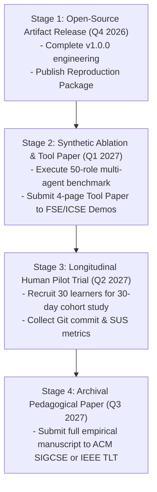

# Kordexa Documentation — Publication Strategy & Submission Roadmap

**Document Status:** Complete  
**Date:** 2026-10-29  
**Version:** 1.0.0  
**Target Submission Window:** 2027

---

## 1. Executive Summary

This document evaluates the most defensible academic and practitioner publication venues for Kordexa. Rather than assuming that repository documentation alone suffices for academic acceptance, we systematically assess target venues, evaluate specific evidence requirements, and identify the **minimum viable empirical work** required prior to formal submission.

---

## 2. Evaluation of Potential Publication Tracks

```
+-----------------------------------------------------------------------------------------+
|                               PUBLICATION ROUTE EVALUATION                              |
+-----------------------------------------------------------------------------------------+
| Route 1: ACM SIGCSE Technical Symposium (Computing Education Track)                    |
|   - Scope: Computer science pedagogy, developer training, innovative tools for study   |
|   - Contribution Type: Full Research Paper (empirical) or Experience Report            |
+-----------------------------------------------------------------------------------------+
| Route 2: IEEE Transactions on Learning Technologies (TLT)                               |
|   - Scope: Advanced learning systems, AI in education, intelligent tutoring            |
|   - Contribution Type: Archival Journal Article                                         |
+-----------------------------------------------------------------------------------------+
| Route 3: ICSE / FSE Tool Demonstrations & Artifact Track                                |
|   - Scope: Software engineering tools, developer productivity, agent systems            |
|   - Contribution Type: Formal Tool Demonstration Paper (4 pages + Open Source Artifact) |
+-----------------------------------------------------------------------------------------+
| Route 4: NeurIPS / ICLR Workshop on Agentic AI & Generative Workflows                  |
|   - Scope: Multi-agent coordination, human-agent interaction, prompt contracts         |
|   - Contribution Type: Short Workshop Paper (4-6 pages)                                 |
+-----------------------------------------------------------------------------------------+
```

---

## 3. Venue-by-Venue Comparative Assessment

### 3.1 Option A: ICSE / FSE Tools & Demonstrations Track (Recommended Short-Term)
- **Primary Venues:**
  - **FSE (ACM International Conference on the Foundations of Software Engineering) — Demonstrations Track**
  - **ICSE (IEEE/ACM International Conference on Software Engineering) — Tool Demonstrations Track**
- **Audience:** Software engineering researchers, developer tool architects, empirical SE community.
- **Novelty Expectations:** Demonstrable novelty in tool design, practical developer utility, zero-dependency local architecture, and agentic interoperability.
- **Evidence Required:**
  - Working open-source repository with public artifact release.
  - Reproducibility documentation and automated test harness (all satisfied).
  - Walkthrough video or interactive demonstration script.
  - Qualitative feedback from early adopters or developer case studies ($N=3\text{--}5$).
- **Fit for Kordexa:** **Extremely High.** Kordexa's zero-dependency CLI, multi-adapter generation, and token-conscious harness provide an ideal software artifact.
- **Minimum Work Needed:** A 3-minute demonstration screencast and a formal 4-page paper formatted to the ACM/IEEE template.

### 3.2 Option B: ACM SIGCSE (Computer Science Education)
- **Primary Venue:** **ACM Technical Symposium on Computer Science Education (SIGCSE)**
- **Audience:** CS educators, educational technology researchers, professional training leads.
- **Novelty Expectations:** Empirical evidence demonstrating improved student learning outcomes, reduced attrition, or enhanced deliberate practice in programming.
- **Evidence Required:**
  - Controlled human participant trial (minimum $N=20\text{--}30$ learners over a 30-day curriculum).
  - Pre- and post-intervention diagnostic skill assessments.
  - Qualitative thematic analysis of learner journal logs and blocker reflections.
- **Fit for Kordexa:** **High (Medium-Term).** The educational philosophy (one artifact/day, proof logging) aligns directly with SIGCSE's pedagogy focus.
- **Minimum Work Needed:** Complete the planned human subject pilot study outlined in `docs/EVALUATION_PLAN.md` before submission.

### 3.3 Option C: NeurIPS / ICLR Workshop on Multi-Agent Systems
- **Primary Venues:**
  - **Workshop on Foundation Model Agents (NeurIPS)**
  - **Workshop on LLM Agents & Collaboration (ICLR)**
- **Audience:** AI agent researchers, multi-agent systems engineers.
- **Novelty Expectations:** Rigorous analysis of agent decomposition, context-window management, and human-in-the-loop coordination.
- **Evidence Required:**
  - Synthetic ablation study comparing monolithic LLM prompt vs. 6-role sequential pipeline.
  - Token consumption and cost measurements across models.
- **Fit for Kordexa:** **Medium-High (Short-Term).** Can be prepared rapidly using synthetic LLM evaluation without waiting for a 30-day human study.

---

## 4. Recommended Staged Submission Roadmap



---

## 5. Artifact Availability & Open Science Checklist

To ensure acceptance in premier software engineering tracks, the repository satisfies the ACM Artifact Evaluation guidelines:

- [x] **Available:** Hosted publicly on GitHub under an OSI-approved license (MIT).
- [x] **Functional:** Verified 22-test automated regression suite passing in $< 300\text{ms}$.
- [x] **Reusable:** Clear installation steps, `.env.example`, and zero-dependency packaging.
- [x] **Documented:** Comprehensive architecture diagrams (`spec.c4`, `SYSTEM_ARCHITECTURE.md`), audit findings, and reproduction guides.
- [ ] **Demonstrated:** 3-minute video screencast illustrating setup, research, and proof logging (Action item for Stage 2).

