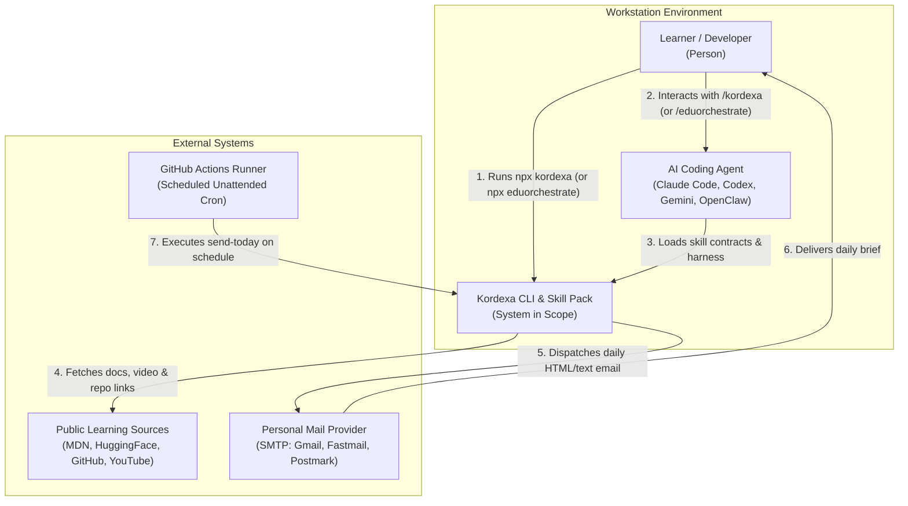
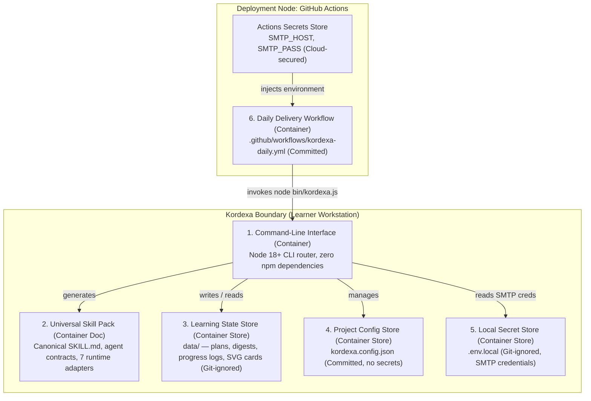
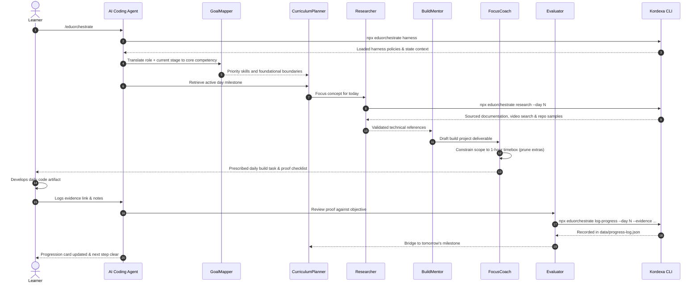

# Kordexa Documentation — System Architecture Specification

**Document Status:** Complete  
**Date:** 2026-10-29  
**Version:** 1.0.0  
**Specification Model:** Aligned with `spec.c4` (LikeC4 v1.59.2 verified model)

---

## 1. System Context (C4 Level 1)

Kordexa provides a local-first learning command center that transforms a target professional engineering role into a 30+ day adaptive curriculum. It operates directly within the developer's workstation and connects to external coding agents, public knowledge sources, and personal SMTP servers without requiring any hosted SaaS infrastructure.

---

## 2. Container Architecture (C4 Level 2)

Kordexa enforces a strict local ownership boundary. All state is backed by local disk files and owned completely by the learner.

---

## 3. CLI Component Architecture (C4 Level 3)

The CLI container (`src/`) is designed as a set of decoupled, single-responsibility modules:

```mermaid
classDiagram
    class CLI_Router {
        +main(argv)
        +resolveScheduledDay(config, plan, now)
        -init(argv)
        -sendToday(argv)
        -regeneratePlan(argv)
        -showStatus()
        -doctor()
    }

    class Config_Manager {
        +readJson(filePath, fallback)
        +writeJson(filePath, payload)
        +validateConfig(config)
        +loadConfig(rootDir)
        +saveConfig(config, rootDir)
        +loadEnvFile(filePath)
    }

    class Curriculum_Planner {
        +generate30DayPlan(profile)
        +renderDailyEmail(config, plan, day, options)
        -prioritizeTopics()
        -buildDay()
    }

    class Research_Engine {
        +createResearchDigest(options)
        +enrichDigestLinks(digest, options)
        +resolveVideos(query, limit)
        +resolveRepos(query, limit)
        +isLinkResolutionOffline(options)
    }

    class Progress_Tracker {
        +appendProgress(config, entry)
        +reviewProgress(config, plan)
        +createWeeklySummary(config, plan, week)
        +planStatus(config, plan)
    }

    class Card_Renderer {
        +buildProgressionCard(config, plan)
        +saveProgressionCard(config, card)
        +copyDefaultTerminalCard(config)
        +TerminalCardSvg(options)
    }

    class Email_Mailer {
        +smtpConfigFromEnv(env)
        +sendMail(options)
        -upgradeToTls(socket, host)
        -renderSmtpMessage(from, message)
    }

    class Harness_Generator {
        +createHarness(config, plan, mode)
        +saveHarness(config, harness)
    }

    class Course_Curator {
        +createCoursePack(config, plan)
        +saveCoursePack(config, pack)
    }

    class Adapter_Writer {
        +writeAgentAdapters(rootDir)
    }

    class Workflow_Writer {
        +cronFromTime(time, tz)
        +writeGithubWorkflow(config, rootDir)
    }

    CLI_Router --> Config_Manager
    CLI_Router --> Curriculum_Planner
    CLI_Router --> Research_Engine
    CLI_Router --> Progress_Tracker
    CLI_Router --> Card_Renderer
    CLI_Router --> Email_Mailer
    CLI_Router --> Harness_Generator
    CLI_Router --> Course_Curator
    CLI_Router --> Adapter_Writer
    CLI_Router --> Workflow_Writer
```

---

## 4. Multi-Agent Sequential SOP Pipeline

The skill pack instructs the host agent to execute a sequential six-stage Standard Operating Procedure (SOP):

---

## 5. Security & Isolation Boundaries

1. **Network Boundary:** The CLI runs exclusively offline unless:
   - `enrichDigestLinks` is invoked without `--offline`, fetching search results with a 7-second timeout.
   - `send-today` is invoked without `--dry-run`, initiating an encrypted SMTP socket (TLS 1.2+).
2. **Secrets Boundary:** SMTP passwords (`SMTP_PASS`) are:
   - Read from `.env.local` for local execution (strictly Git-ignored).
   - Read from GitHub Actions Secrets for scheduled cron execution.
   - Never echoed in JSON logs, progress files, progression cards, or Git commits.
3. **Execution Sandbox:** The CLI performs purely deterministic file operations. It executes zero `eval()`, zero `exec()`, and zero untrusted child processes.

