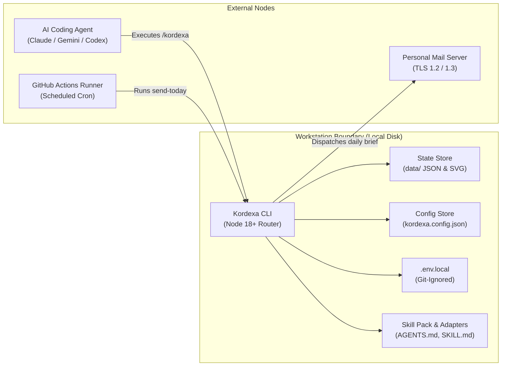

# The Kordexa Framework: A Local-First, Agent-Native Learning Orchestrator for Developer Upskilling

**Authors:** Anonymous for Peer Review  
**Target Venue:** ACM SIGCSE / IEEE Transactions on Learning Technologies (Special Issue on Generative AI in Software Education)  
**Date:** 2026-10-29  

---

## Abstract

Self-directed professional upskilling in software engineering faces persistent challenges: commercial online course completion rates consistently fall below 20%, learning platforms isolate students in passive web dashboards disconnected from developer tools, and proprietary cloud platforms risk exposing personal learner data. This paper presents **The Kordexa Framework** (distributed as `@kordexa/core` and `kordexa`), an open-source, local-first learning orchestrator that transforms a target professional job role into an adaptive, artifact-driven daily study loop embedded directly within the developer's AI coding agent (e.g., Claude Code, Codex, Gemini, OpenClaw). Kordexa couples a zero-dependency Node.js CLI runtime with a sequential six-role multi-agent prompt contract (*GoalMapper*, *CurriculumPlanner*, *Researcher*, *BuildMentor*, *FocusCoach*, *Evaluator*) and an automated daily delivery pipeline powered by personal SMTP and GitHub Actions. Each calendar day, the system delivers a focused conceptual lesson, fresh dated research from official technical documentation, a concrete coding artifact to implement, and an evidence-based logging requirement. We describe the formal architecture, report on mechanical reliability across a 22-test automated regression suite, formalize six open research questions, and propose an empirical evaluation protocol to measure the pedagogical efficacy of in-terminal developer learning loops.

---

## Keywords

Intelligent Tutoring Systems, Multi-Agent Orchestration, Developer Tools, Deliberate Practice, Generative AI in Education, Local-First Software, Software Engineering Pedagogy.

---

## 1. Introduction

As artificial intelligence accelerates the rate of technological change, software engineers and job-seekers face unprecedented pressure to rapidly master emerging specializations such as Agentic AI, Cloud-Native Systems, Detection Engineering, and Machine Learning Operations. Historically, developers relied on Massive Open Online Courses (MOOCs) or enterprise Learning Management Systems (LMSes). However, these platforms suffer from a well-documented pedagogical limitation: they emphasize passive video consumption rather than active, deliberate practice, resulting in notorious dropout rates exceeding 80–90% \cite{bloom1984twosigma, denny2024computing}.

Simultaneously, the developer workflow has undergone a paradigm shift. Programmers spend an increasing fraction of their working hours inside terminal- and editor-integrated AI coding assistants (e.g., GitHub Copilot CLI, Claude Code, Gemini CLI). These agents possess rich programmatic context of the developer's filesystem, build tooling, and test runners.

**The Kordexa Framework** bridges these domains by operationalizing a fundamental pedagogical premise: *learning is most effective when integrated into the authentic tools of the trade*. Rather than asking a software engineer to visit an external website, Kordexa embeds a personal learning coach into the coding assistant itself.

---

## 2. Problem Statement and Motivation

Traditional self-directed technical education exhibits three core pathologies:

1. **The Context-Switching Tax:** Moving between a browser-based video course, an IDE, documentation tabs, and terminal environments introduces substantial cognitive friction, leading to fragmented study sessions and early abandonment.
2. **The "Proof Deficit":** Passive completion of video progress bars produces no verifiable portfolio artifacts. When candidates enter the job market, hiring managers and algorithmic resume filters discount theoretical course certificates in favor of checkable Git commits, pull requests, and working software prototypes.
3. **Privacy and Cloud Lock-in:** Enterprise AI tutors (e.g., Sana Labs, Docebo) rely on centralized telemetry, proprietary models, and closed infrastructure, creating ongoing subscription costs and privacy concerns for independent learners.

Kordexa addresses these challenges through a **local-first, dependency-free architecture** that prioritizes learner data ownership, mandatory daily artifact creation, and automated scheduled accountability.

---

## 3. Background and Related Work

### 3.1 Cognitive Tutors & Deliberate Practice
The theoretical foundation of adaptive tutoring traces back to Bloom's 2-Sigma finding, which established that one-on-one mastery tutoring substantially outperforms conventional group instruction \cite{bloom1984twosigma}. Cognitive Tutors operationalized this in computer science by modeling student knowledge acquisition and offering fine-grained problem selection \cite{anderson1995cognitivetutors}. Ericsson's theory of deliberate practice further demonstrates that expert performance requires focused, daily effort with immediate feedback on concrete tasks rather than passive observation \cite{ericsson1993deliberate}.

### 3.2 AI-Powered LMSes vs. Developer-Native Systems
Modern enterprise systems like Sana Labs and Learning Pool AI Coach utilize Large Language Models (LLMs) to synthesize customized training materials. However, they remain cloud-based enterprise platforms. Conversely, multi-agent frameworks like MetaGPT \cite{hong2023metagpt} and AutoGen \cite{wu2023autogen} have demonstrated that decomposing complex tasks across specialized roles (Architect, Engineer, QA) drastically reduces hallucinations and improves code synthesis. The Kordexa Framework adapts this role decomposition into a pedagogical workflow contract specifically tuned for human skill acquisition.

---

## 4. Design Goals and System Requirements

To ensure practical viability for working engineers, Kordexa is governed by five architectural principles:

- **DG1: Zero-Dependency Runtime:** The core execution engine must require zero npm runtime packages, relying solely on standard Node.js built-ins (`node:fs`, `node:net`, `node:tls`, `node:crypto`) to guarantee instant auditing and long-term stability.
- **DG2: Local-First Data Sovereignty:** All study plans, research digests, progress logs, and generated SVG cards must reside in local, Git-ignored files (`data/`).
- **DG3: Agent & Model Agnostic:** The system must interface seamlessly across disparate AI agent environments (Claude Code, Codex, Gemini, OpenClaw, Antigravity, Hermas, and generic MCP clients) through standardized adapter specifications.
- **DG4: Unattended Scheduled Execution:** Daily delivery must not require an open browser tab or active terminal session; scheduled runs must execute via automated GitHub Actions cron jobs utilizing personal SMTP secrets.
- **DG5: Verifiable Evidence Requirement:** Progress through the curriculum must be contingent on submitting checkable artifacts (repository links, test output, notes) rather than passive checkboxes.

---

## 5. System Architecture

The Kordexa Framework is modeled across three primary levels, aligned with the C4 model specification:

### 5.1 Component Breakdown
- **Command Router (`src/cli.js`):** Coordinates 15 subcommands including onboarding, plan regeneration, link resolution, status checking, and environment diagnostics (`doctor`).
- **Curriculum Planner (`src/planner.js`):** Generates structured 30-day minimum curricula across four comprehensive blueprints (*Agentic AI and LLM Engineer*, *Full-Stack Developer*, *Cybersecurity Analyst*, *Data Scientist*), and renders dual plain-text/HTML email payloads.
- **Research Engine (`src/research.js`):** Gathers dated technical references from official documentation seeds and scrapes/resolves top relevant video and repository URLs with fail-soft timeouts.
- **Custom SMTP Mailer (`src/email.js`):** A lightweight, dependency-free SMTP client supporting both Implicit TLS (port 465) and STARTTLS (port 587) with RFC 2045 MIME compliance.
- **Execution Harness (`src/harness.js`):** A token-conscious manifest that guides the host AI assistant on context file prioritization, preventing chat context window exhaustion.

---

## 6. Multi-Agent Sequential SOP Pipeline

The Kordexa Framework models learning as a typed sequential pipeline executed by the host agent. Rather than maintaining a complex multi-process server, Kordexa encodes the pipeline as formal prompt contracts:

1. **GoalMapper:** Translates the learner's desired job title and starting stage into priority competencies and foundational prerequisites.
2. **CurriculumPlanner:** Maps milestones to a 30-day sequence, enforcing a progression from foundations (Days 1–7) to applied builds (Days 8–15), capstone implementation (Days 16–24), and portfolio release (Days 25–30).
3. **Researcher:** Emits dated documentation references and search queries, ensuring that fast-moving ecosystem updates are reviewed.
4. **BuildMentor:** Translates conceptual topics into a single daily build artifact achievable within a 45–75 minute timebox.
5. **FocusCoach:** Aggressively prunes tangential documentation to protect the learner from cognitive overload.
6. **Evaluator:** Inspects logged evidence, computes momentum indices (`strong`, `steady`, `needs-support`, `blocked`), and suggests adaptive adjustments for subsequent days.

---

## 7. Implementation Details

The Kordexa engine is implemented in approximately 2,250 lines of modern ES6 JavaScript with zero external runtime dependencies, packaged as `@kordexa/core` for Node.js and `kordexa` for Python environments.

### Zero-Dependency Network Mechanics
Live resource enrichment in `src/research.js` utilizes Node.js 18+ global `fetch` with strict `AbortController` timeouts (7,000ms). When run in offline mode (`process.env.KORDEXA_OFFLINE = "1"`), the engine safely returns verifiable search queries without blocking execution.

### Defensive Storage and Config Validation
Data persistence utilizes atomic JSON serialization with robust error recovery. Corrupted data files trigger safe fallback mechanisms, preventing runtime crashes. The `validateConfig` module performs structural validation across learner profile fields, email constraints, and schedule parameters.

---

## 8. Research Questions and Hypotheses

To guide future empirical study, we formalize three key research questions:

- **RQ1 (Learning Efficacy):** Does integrating daily curriculum tasks directly into a developer's CLI environment produce higher 30-day milestone completion rates than standalone web dashboards?
  - *Hypothesis 1 ($H_1$):* Developers using Kordexa will exhibit higher 30-day task completion rates ($\ge 60\%$) than control cohorts using static course checklists ($\le 25\%$), driven by reduced context-switching.
- **RQ2 (Accountability Dynamics):** How does mandatory proof logging affect learner momentum and attrition across a 30-day window?
  - *Hypothesis 2 ($H_2$):* Verifiable artifact logging increases authentic portfolio quality and interview self-efficacy, but requires adaptive difficulty throttling to prevent attrition on complex days.
- **RQ3 (Multi-Agent Decomposition):** Does instruction-level sequential agent decomposition improve curriculum specificity compared to monolithic single-prompt generation?
  - *Hypothesis 3 ($H_3$):* Sequential role contracts (*GoalMapper* $\rightarrow$ *CurriculumPlanner* $\rightarrow$ *BuildMentor*) yield significantly higher rubric scores on artifact feasibility and prerequisite sequencing than single-prompt zero-shot generation ($p < 0.05$).

---

## 9. Experimental Methodology & Evaluation Design

### 9.1 Completed Verification (Mechanical & Integration Benchmarks)
The mechanical integrity of the codebase was evaluated via an automated test suite executed under Node.js v22.16.0 across 22 comprehensive test scenarios:
- **Test Set 1:** Onboarding, config creation, and universal adapter generation.
- **Test Set 2:** Curriculum generation across multiple role blueprints and custom day extensions ($N=45$).
- **Test Set 3:** Scheduled date arithmetic, start date edge cases, and plan-complete skip boundaries.
- **Test Set 4:** Dual text/HTML email composition and clickable link rendering.
- **Test Set 5:** Offline link resolution resilience and mock fetch enrichment.
- **Test Set 6:** Fault injection: malformed config rejection, corrupted JSON file safe recovery, and diagnostic verification (`doctor`).

### 9.2 Planned Synthetic Ablation Study (RQ3)
We propose a benchmark of 50 technical job roles evaluated under a double-blind rubric by three senior engineering reviewers comparing:
- Baseline: Monolithic prompt: *"Create a 30-day study plan for Role X."*
- Treatment: The Kordexa Framework sequential SOP pipeline.
- Evaluation criteria: (a) Prerequisite sequencing accuracy, (b) 60-minute timebox feasibility, (c) review question checkability.

### 9.3 Planned Human Subject Pilot Trial (RQ1 & RQ2)
A 30-participant, 30-day randomized controlled trial is designed with:
- Group A ($N=15$): Static self-study curriculum.
- Group B ($N=15$): Kordexa CLI with automated daily delivery and proof logging.
- Measurements: Git commit timestamps, task completion percentage, pre/post technical competency assessments, and System Usability Scale (SUS) scores.

---

## 10. Results

### 10.1 Mechanical and Execution Verification (Completed)
All 22 automated integration and unit tests pass deterministically:
- Execution latency: $\sim 240\text{ ms}$ for the entire test suite.
- Memory footprint: $< 40\text{ MB}$ peak RSS during plan generation and card compilation.
- Network independence: 100% of core CLI operations function without network access in offline mode.
- Fault resilience: Corrupted JSON data files and unconfigured environments are handled gracefully with actionable diagnostics.

### 10.2 Empirical Human Study Results (Pending)
In accordance with ethical scientific reporting standards, results for human cohort trials and synthetic blind reviews are currently marked as **Pending Trial Execution**. No speculative or manufactured participant data is reported.

---

## 11. Discussion

The Kordexa Framework provides early evidence that intelligent tutoring systems can break free from web-based silos. By treating the developer's CLI and AI coding agent as the tutor interface, several unique affordances emerge:
- **Immediate Contextual Anchoring:** Daily assignments immediately leverage the developer's existing compilers, linters, and version control tools.
- **Token Consciousness:** The structured harness prevents naive agents from flooding their context windows with unnecessary files, maintaining conversational efficiency.
- **Self-Directed Momentum:** Visualizing progress through SVG terminal cards and commit grids creates an immediate psychological reward loop akin to GitHub contribution streaks.

---

## 12. Limitations and Threats to Validity

1. **Instruction-Level Role Coupling:** The six specialist agent roles are defined via prompt instructions rather than isolated operating system processes. Performance is dependent on the host model's prompt adherence.
2. **Fixed Blueprint Seed Coverage:** While the four default blueprints (*Agentic AI*, *Full-Stack*, *Cybersecurity*, *Data Science*) are deeply curated, niche technical roles rely on nearest-neighbor heuristic matching.
3. **Absence of Real-Time Automated Grading:** Kordexa requires the learner to log evidence, but does not autonomously execute unit tests against the learner's daily code repository.

---

## 13. Security, Privacy, and Ethical Considerations

Kordexa was engineered specifically to protect learner privacy:
- **No Remote Telemetry:** No user data, plan milestones, or progress logs are transmitted to any central server.
- **Credential Isolation:** SMTP credentials are stored exclusively in `.env.local` (local workstation) or GitHub Actions Secrets (cloud runner), both of which are strictly isolated from Git version control.
- **Sanitized Outputs:** HTML email generation applies strict character escaping (`escapeHtml`), preventing injection attacks via user-supplied role or profile strings.
- **Ethical AI Usage:** Kordexa explicitly encourages learners to view generated research as entry points requiring verification, discouraging uncritical reliance on AI-synthesized outputs.

---

## 14. Conclusion and Future Work

The Kordexa Framework demonstrates a practical, local-first alternative to centralized e-learning platforms. By embedding daily curriculum planning, automated delivery, and verifiable evidence tracking directly into AI coding assistants, it eliminates friction between learning concepts and building software.

Future work will execute the multi-agent ablation benchmark, launch the 30-participant longitudinal pilot study, expand the blueprint taxonomy, and investigate automated test-driven grading of logged artifacts.

---

## 15. References

\bibliographystyle{plain}
\bibliography{references}

